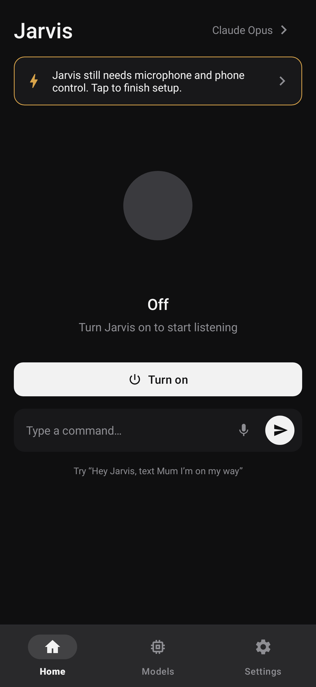
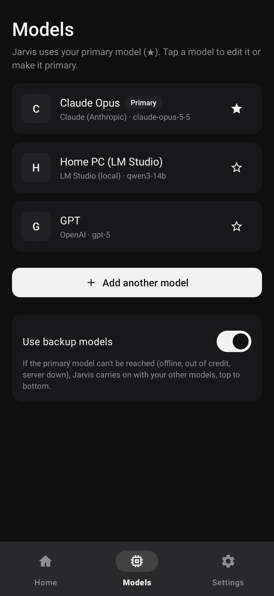
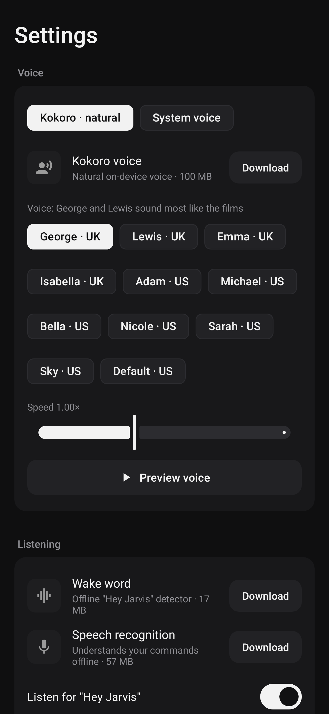
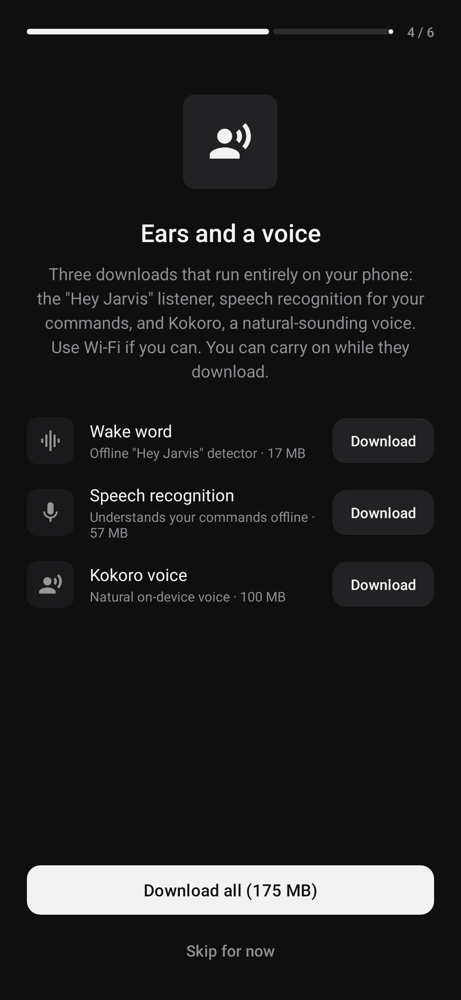
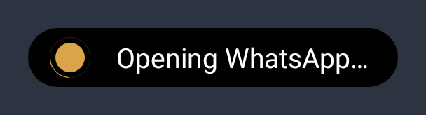
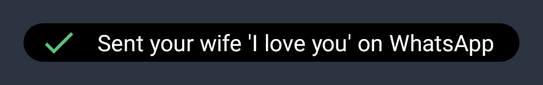
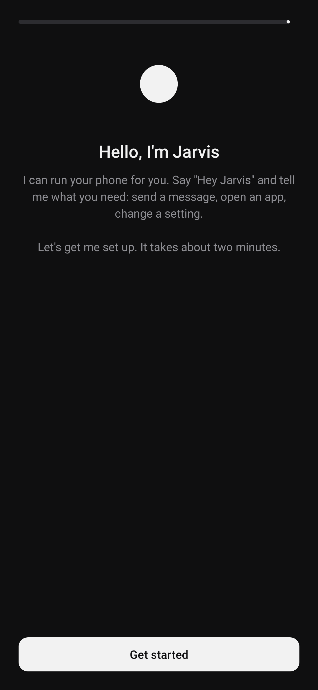
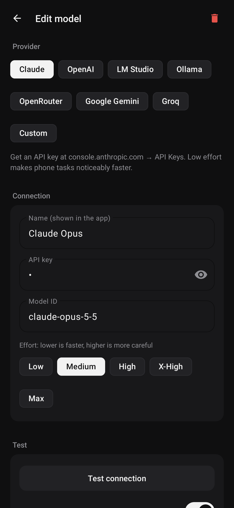
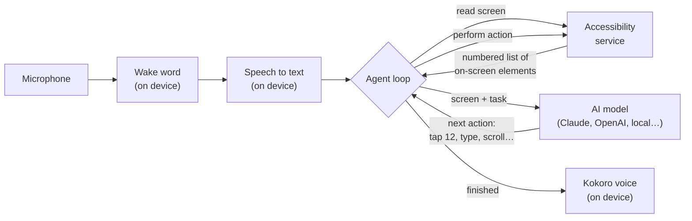

<div align="center">


# Jarvis

**A voice assistant for Android that uses your phone for you.**

Say *"Hey Jarvis, text Mum I'm on my way"* and Jarvis opens the app, finds the chat, types the message, sends it and tells you when it's done. It works with Claude, OpenAI, or a model running on your own computer.

[](LICENSE)
[](#requirements)
[](https://kotlinlang.org)
[](https://github.com/judejulius/jarvis-android/actions/workflows/ci.yml)
[](https://github.com/judejulius/jarvis-android/releases)
[](https://github.com/judejulius/jarvis-android/stargazers)

[Download](#install) · [Features](#features) · [How it works](#how-it-works) · [Contributing](CONTRIBUTING.md)

<br />

&nbsp;
&nbsp;
&nbsp;


</div>

---

## Table of contents

- [Why Jarvis?](#why-jarvis)
- [Features](#features)
- [Install](#install)
- [First-time setup](#first-time-setup)
- [AI providers](#ai-providers)
- [How it works](#how-it-works)
- [Building from source](#building-from-source)
- [Project structure](#project-structure)
- [Privacy and safety](#privacy-and-safety)
- [Limitations](#limitations)
- [Roadmap](#roadmap)
- [Contributing](#contributing)
- [Acknowledgements](#acknowledgements)
- [License](#license)

## Why Jarvis?

Phone assistants can answer questions, but most of them can't use your apps for you. Jarvis can. It reads the screen through Android's accessibility service, decides what to tap and type with the AI model you choose, and keeps going until the job is done.

- **Hands-free.** Wake word detection, speech recognition and the voice all run on the phone.
- **Your choice of model.** Use Claude, OpenAI, Gemini, Groq or OpenRouter, or keep everything at home with LM Studio or Ollama.
- **Works with any app.** Jarvis uses apps the way you do, so it doesn't need special integrations.
- **Open source** under the MIT licence.

## Features

### Voice, on the phone
- **"Hey Jarvis" wake word.** Offline keyword spotting with [sherpa-onnx](https://github.com/k2-fsa/sherpa-onnx), so no audio leaves the phone while it waits.
- **One-breath commands.** "Hey Jarvis, turn on the flashlight" works without waiting for a prompt. If you pause after "Hey Jarvis", it asks "Yes?".
- **Offline speech recognition** with a streaming Zipformer model. Google's recognizer is used only if you skip that download.
- **A natural voice.** [Kokoro](https://huggingface.co/hexgrad/Kokoro-82M) runs locally with 11 voices (British and American). Android's built-in voice is the fallback.
- Jarvis mutes its own microphone while speaking, so it never hears itself.

### Phone control
- Taps, long-presses, types, scrolls, swipes, presses Back/Home and opens apps.
- Can take screenshots for vision models when the screen text isn't enough.
- Asks you a spoken question when it needs to, for example *"Which Sarah, Sarah Jones or Sarah Lee?"*
- Wakes the screen and asks you to unlock when the phone is locked.

### Many models, with backups
- Add as many models as you like and star one as the primary.
- **Backup models.** If the primary fails mid-task (offline, out of credit, server down), the next one takes over and is told what's already been done.
- Each model has a **Test connection** button.

### Built for everyday use
- **Task island.** A small pill at the top of the screen shows what Jarvis is doing. Tap it to stop.
- Runs as a foreground service, and can start at boot.
- A setup walkthrough covers permissions, phone control, battery settings and downloads.
- **"About you" notes** help with names, e.g. *"My wife is saved as 'Amaka' in WhatsApp."*
- **Crash reports.** If the app crashes, the next launch offers a report you can share.

<div align="center">
&nbsp;&nbsp;

</div>

## Install

### Requirements
- Android 8.0 (API 26) or newer.
- A 64-bit ARM phone (`arm64-v8a`). That's nearly every phone from the last several years.
- About 300 MB of free space: the app plus 175 MB of voice models, downloaded in the app.
- An API key for a cloud model, **or** a computer running LM Studio or Ollama.

### Download
1. Get the latest `Jarvis-*.apk` from [**Releases**](https://github.com/judejulius/jarvis-android/releases).
2. Open it on your phone. If asked, allow your browser or file manager to **install unknown apps**.
3. Open Jarvis and follow the setup walkthrough.

> Jarvis is not on the Play Store. Google restricts apps that use the accessibility service the way Jarvis does, so it's distributed for sideloading.

## First-time setup

The walkthrough guides you through each step and ticks it off when it's done. You can run it again from Settings.

| Step | What it's for |
|---|---|
| **Microphone and notifications** | Hearing "Hey Jarvis", and the status notification. |
| **Phone control** (accessibility service) | Reading the screen and tapping and typing for you. On Android 13+ you may see *"Restricted setting"*. Fix it in *Settings → Apps → Jarvis → ⋮ → Allow restricted settings*, then try again. |
| **Background running** | Stops Android from closing Jarvis. On Samsung, Xiaomi, Huawei and similar phones, also set Jarvis to *Unrestricted* in its battery settings. |
| **Downloads** (175 MB, use Wi-Fi) | Wake word (17 MB), speech recognition (57 MB) and the Kokoro voice (100 MB). |
| **A model** | Choose a provider, paste a key, and tap *Test connection*. |

<div align="center">
&nbsp;

</div>

## AI providers

| Provider | Default model | Notes |
|---|---|---|
| **Claude** (Anthropic) | `claude-opus-5-5` | Uses the official Anthropic Java SDK. The *Effort* setting trades speed for care; *Low* is noticeably faster for simple tasks. |
| **OpenAI** | `gpt-5` | Any model on your account that supports tool calling. |
| **LM Studio** | `local-model` | Turn on *Serve on local network* and use `http://<your-PC-IP>:1234/v1`. Pick a model that supports tool calling, such as Qwen 3 or Llama 3.1+. |
| **Ollama** | `qwen2.5:14b` | Run with `OLLAMA_HOST=0.0.0.0` and use `http://<your-PC-IP>:11434/v1`. |
| **OpenRouter, Gemini, Groq, Custom** | editable | Any OpenAI-compatible `/chat/completions` endpoint with tool calling. |

Small local models struggle with long, multi-step phone tasks. If results are unreliable, try a bigger model, or turn on screenshots with a vision model.

## How it works



1. **Listen.** One microphone stream feeds the wake word detector. After "Hey Jarvis", the same audio, including the moment just before the wake word, goes to the speech recognizer, so nothing you say is cut off.
2. **Look.** The accessibility service turns the current screen into a compact numbered list, like `[12] Button "Send"`.
3. **Think.** The model gets the task, the screen and a set of tools: `tap`, `type_text`, `scroll`, `swipe`, `open_app`, `press_key`, `look_at_screen`, `ask_user`, `finish` and more. It picks one action.
4. **Act.** Jarvis performs the action, reads the screen again and repeats until the model calls `finish`.
5. **Reply.** The result is spoken aloud and shown on the task island.

## Building from source

You need **JDK 17+** and the **Android SDK** (API 35). Android Studio provides both.

```bash
git clone https://github.com/judejulius/jarvis-android.git
cd jarvis-android
./gradlew assembleDebug        # the first build downloads sherpa-onnx (50 MB)
adb install -r app/build/outputs/apk/debug/app-debug.apk
```

Run the tests:

```bash
./gradlew testDebugUnitTest    # UI flows, crash safety, layout checks; screenshots go to app/build/screenshots
./gradlew lintDebug
```

You can also run the voice pipeline against the real speech engine and models on your computer. See [CONTRIBUTING.md](CONTRIBUTING.md#real-engine-tests).

## Project structure

```
app/src/main/java/com/jarvis/assistant/
├── agent/
│   ├── PhoneAgent.kt              # the agent loop, system prompt and tools
│   ├── Llm.kt                     # ChatSession interface and connection test
│   ├── AnthropicSession.kt        # Claude via the official SDK
│   └── OpenAiCompatibleSession.kt # OpenAI, LM Studio, Ollama, OpenRouter, Gemini, Groq
├── accessibility/
│   ├── JarvisAccessibilityService.kt  # taps, typing, gestures, screenshots
│   └── ScreenReader.kt                # screen → numbered element list
├── voice/
│   ├── VoiceInput.kt         # microphone, wake word and offline speech recognition
│   ├── Kokoro.kt             # on-device neural voice
│   ├── Voice.kt, SystemVoice.kt
│   ├── CommandListener.kt    # Google speech recognizer fallback
│   └── ModelDownloader.kt    # downloads and safely unpacks the models
├── service/
│   ├── JarvisService.kt      # foreground service: wake → listen → act → reply
│   └── BootReceiver.kt
├── ui/                       # Home, Models, Settings, onboarding, task island
├── Settings.kt               # preferences, providers and model profiles
└── CrashReporter.kt
```

## Privacy and safety

- **What stays on your phone:** the microphone audio, the wake word, speech recognition and the voice.
- **What gets sent:** while a task is running, the text on your screen (and screenshots, if you turn them on) goes to the model provider you chose. For full privacy, use LM Studio or Ollama on your own computer.
- **API keys** are stored in the app's private storage and only sent to the provider they belong to.
- **Safety rules.** Jarvis is told to ask before payments, purchases, deletions or security changes, to ask when a contact is ambiguous, and to treat text on screen as content, not instructions. These rules live in the prompt, and **models can still make mistakes**. Watch what it does until you trust it. You can stop a task at any time from the task island or the notification.

Found a security problem? Please see [SECURITY.md](SECURITY.md).

## Limitations

- **Android only.** iOS doesn't allow one app to control others.
- **The phone must be unlocked** for Jarvis to act. Android doesn't allow accessibility actions behind the lock screen.
- **Wake word accuracy** was measured with synthetic speech (18/18 detected, 0/60 false alarms on sound-alike phrases). Real rooms are noisier. The mic button and the notification's *Talk* button always work.
- **Android 14+** may block a microphone service from starting at boot. If so, open the app once.
- **Battery:** listening for the wake word uses a little power continuously.

## Roadmap

Ideas we'd love help with:

- [ ] More languages for the wake word, speech recognition and voice
- [ ] Custom wake words
- [ ] 32-bit ARM and x86_64 builds
- [ ] Task history with replay of each step
- [ ] Per-app tips that help the model (e.g. "In WhatsApp, the search icon is…")
- [ ] Translations of the app interface

## Contributing

Contributions are welcome: bug reports, testing on more phones, new providers, translations and code. See **[CONTRIBUTING.md](CONTRIBUTING.md)** for how to build, test and send a pull request. Everyone taking part is expected to follow the [Code of Conduct](CODE_OF_CONDUCT.md).

## Acknowledgements

Jarvis is built on these open-source projects and models. Each keeps its own licence.

| Project | Used for | Licence |
|---|---|---|
| [sherpa-onnx](https://github.com/k2-fsa/sherpa-onnx) | On-device wake word, speech recognition and text-to-speech engine | Apache-2.0 |
| [Kokoro-82M](https://huggingface.co/hexgrad/Kokoro-82M) | The voice | Apache-2.0 |
| [Zipformer keyword spotter](https://k2-fsa.github.io/sherpa/onnx/kws/index.html) (gigaspeech 3.3M) | "Hey Jarvis" detection | See model page |
| [Kroko streaming Zipformer](https://github.com/k2-fsa/sherpa-onnx/releases/tag/asr-models) | Speech recognition | See model page |
| [Anthropic Java SDK](https://github.com/anthropics/anthropic-sdk-java) | Claude API | MIT |
| [OkHttp](https://github.com/square/okhttp) | OpenAI-compatible APIs | Apache-2.0 |
| [Apache Commons Compress](https://commons.apache.org/proper/commons-compress/) | Unpacking model downloads | Apache-2.0 |
| [Material Components](https://github.com/material-components/material-components-android) | UI | Apache-2.0 |

The voice and speech models aren't included in this repository. The app downloads them from the sherpa-onnx releases on first use.

*Jarvis is an independent project. It is not affiliated with or endorsed by Marvel, Disney, Anthropic, OpenAI or Google.*

## License

[MIT](LICENSE). Use it, change it and share it.

<div align="center">
<br />
If Jarvis is useful to you, please consider giving it a star.
</div>
